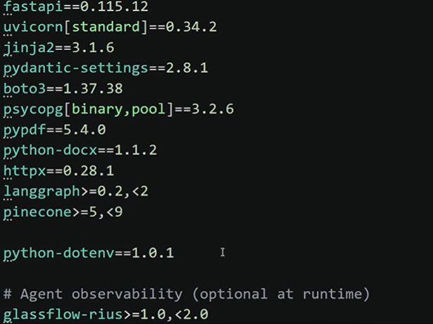
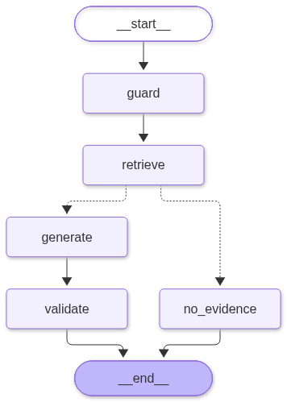

# VERITAS---Rag

1. Initialization of environment

```bash
    uv init --bare
    uv python pin 3.13
    uv venv
    .venv\Scripts\activate
    uv add -r requirements.txt
```

2. Install these packages from req.txt
    in case, not using uv 
    

##Implementation Steps:
    - **Phase 1 - Infrastructure** : Environment, PostgreSQL, AWS, Pinecone and Rius.


3. Final graph workflow
    