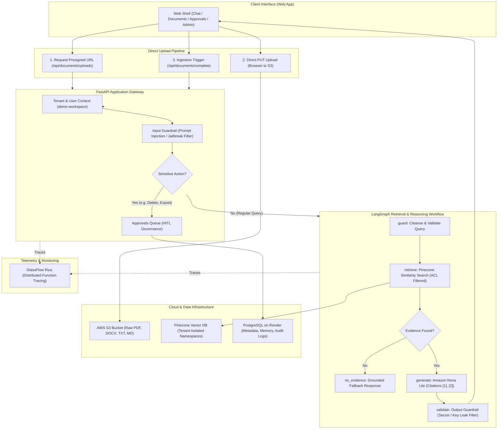
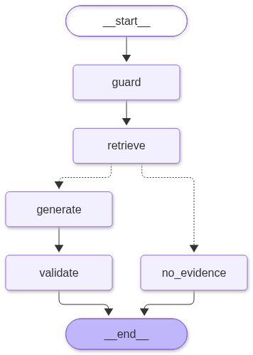

# Veritas — Enterprise Multi-Tenant RAG Platform

> **Veritas** (*Latin for Truth*) is a production-ready, multi-tenant Retrieval-Augmented Generation (RAG) platform. It empowers teams and clients to upload business documents, query them conversationally, and receive reliable answers grounded in verified source evidence with clickable citations, strict data privacy, and built-in human governance.

---

## High-Level Architecture

Veritas is designed around a clean separation of concerns: scalable direct-to-cloud uploads, deterministic security guardrails, an agentic retrieval graph, and an administrative governance layer.



### The LangGraph Agent Flow
The agentic conversation lifecycle is managed via a compiled LangGraph `StateGraph`:



1. **Input Guardrail (`guard`)**: Evaluates the prompt against deterministic security rules to stop jailbreaks, prompt injection, and unauthorized system prompt dumps before any model invocation.
2. **Contextual Retrieval (`retrieve`)**: Combines recent conversation history with the question, embeds it via Amazon Titan v2 (1024 dimensions), and executes an access-controlled similarity search in Pinecone.
3. **Evidence Routing (`route`)**: Conditionally routes to `generate` if relevant context exceeds the similarity threshold (`min_relevance >= 0.25`), or diverts to `no_evidence` to prevent hallucinations.
4. **Grounded Generation (`generate`)**: Prompts Amazon Nova Lite with the untrusted evidence passages, producing an answer with inline numeric citations (`[1]`, `[2]`).
5. **Output Validation (`validate`)**: Inspects the generated response to ensure no sensitive credentials, API keys, or private tokens leak out to the user.

---

## Core Capabilities

- **Grounded Citations**: Answers are backed by exact source document passages and page numbers. The model is strictly instructed never to invent facts beyond the retrieved context.
- **Tenant & Workspace Isolation**: Multi-tenant boundaries are strictly enforced across relational database queries and isolated Pinecone vector namespaces (`tenant-{tenant_id}`).
- **Two-Way Security Guardrails**:
  - *Input*: Regex patterns block prompt-injection attacks, developer prompt disclosure, and unauthorized privilege escalation.
  - *Output*: Inspects LLM answers to prevent accidental leakage of AWS keys, database connection strings, or private certificates.
- **Human-In-The-Loop (HITL) Approvals**: Sensitive operations (e.g., `"delete all documents in your database"` or data exports) are automatically halted. An approval ticket is created for administrator sign-off before execution.
- **Multi-Tier Synchronized Deletion**: When an approved deletion is executed, records are purged cleanly across all three storage layers: PostgreSQL database rows, Pinecone vector embeddings, and AWS S3 files.
- **Direct-to-S3 Ingestion**: Large documents are uploaded directly from the browser to AWS S3 using presigned URLs, bypassing web server bottlenecking and preserving server memory.
- **Conversational Session Memory**: Multi-turn chat context is persisted in PostgreSQL (`chat_messages`), allowing users to ask follow-up questions seamlessly.

---

## Technology Stack

| Domain | Technology | Purpose |
| :--- | :--- | :--- |
| **Backend Framework** | **FastAPI** (Python 3.13) | High-performance asynchronous REST API gateway |
| **Agent Orchestration** | **LangGraph** | Stateful, multi-step agent graphs with conditional routing |
| **Chat Foundation Model** | **Amazon Nova Lite** (`amazon.nova-lite-v1:0`) | Low-latency, cost-effective reasoning via AWS Bedrock |
| **Embedding Model** | **Amazon Titan Embeddings v2** (`amazon.titan-embed-text-v2:0`) | High-accuracy 1,024-dimensional semantic embeddings |
| **Vector Database** | **Pinecone Serverless** (`aws / us-east-1`) | Fast, tenant-isolated cosine similarity vector search |
| **Relational Database** | **PostgreSQL (Render Cloud)** | Metadata, audit trails, approval queues, and chat memory |
| **Object Storage** | **AWS S3** | Secure, durable storage for raw enterprise documents |
| **Observability** | **GlassFlow Rius** | Function-level span tracing for retrieval and inference |
| **Document Parsers** | **pypdf** & **python-docx** | Text and pagination extraction from PDFs and Word documents |
| **Frontend UI** | **Vanilla HTML5, CSS3 & JavaScript** | Clean, responsive web shell with light/dark themes |

---

## Project Development Phases

The development of Veritas followed five structured phases:

```
┌─────────────────────────────────────────────────────────────────────────────┐
│                           PROJECT ROADMAP & PHASES                          │
└─────────────────────────────────────────────────────────────────────────────┘
  Phase 1: Environment & Cloud Infrastructure Setup
  ├── Virtual environment initialization (uv / Python 3.13)
  ├── PostgreSQL schema design (documents, audit_events, approvals, memory)
  └── AWS Bedrock & Pinecone Serverless connectivity

  Phase 2: Ingestion Pipeline & Multimodal Processing
  ├── Direct-to-S3 browser upload using presigned PUT URLs
  ├── Document parsing (PDF & DOCX page-aware extraction)
  └── Chunking (1,000 chars, 180 overlap) & Titan v2 vector upsertion

  Phase 3: LangGraph Agent & Guardrail Architecture
  ├── StateGraph workflow (guard → retrieve → route → generate → validate)
  ├── Two-way deterministic guardrails (injection & secret leak detection)
  └── Multi-turn conversation memory persistence in PostgreSQL

  Phase 4: Governance, Human-In-The-Loop (HITL) & Deletion Engine
  ├── Sensitive prompt detection (purge, wipe, export, delete)
  ├── Approvals queue API & administrative decision handling
  └── Synchronized multi-tier deletion across PostgreSQL, Pinecone, and S3

  Phase 5: User Interface, Observability & Verification
  ├── Responsive web application (Chat, Document Library, Approvals, Admin)
  ├── GlassFlow Rius telemetry instrumentation
  └── Automated unit and integration test suites
```

---

## Directory Structure

```text
VERITAS---Rag/
├── app/                              # Core application backend
│   ├── aws.py                        # AWS Bedrock (Nova Lite & Titan v2) and S3 clients
│   ├── config.py                     # Centralized settings via Pydantic
│   ├── db.py                         # PostgreSQL connection pooling and audit logging
│   ├── deletion.py                   # Multi-tier deletion engine (Postgres, Pinecone, S3)
│   ├── demo_context.py               # Workspace and user identity context
│   ├── graph.py                      # LangGraph StateGraph agent definition
│   ├── guardrails.py                 # Deterministic input & output safety guardrails
│   ├── main.py                       # FastAPI application entrypoint & REST routes
│   ├── memory.py                     # Conversational memory persistence helpers
│   ├── observability.py              # GlassFlow Rius tracing instrumentation
│   ├── rag.py                        # Chat interface bridge to the compiled graph
│   ├── vector.py                     # Pinecone index management and vector search
│   ├── static/                       # Static web assets
│   │   ├── css/style.css             # Interface styling and theme tokens
│   │   └── js/app.js                 # Frontend application logic & API client
│   └── templates/
│       └── index.html                # Unified web shell (Chat, Documents, Approvals, Admin)
├── docs/                             # Project documentation
│   ├── RIUS_OBSERVABILITY.md         # Observability guide
│   └── SETUP.md                      # Complete setup and operations manual
├── infra/
│   └── schema.sql                    # PostgreSQL relational schema and indexes
├── scripts/
│   └── init_db.py                    # Database initialization script
├── tests/                            # Automated test suites
│   ├── bedrock_test.py               # Live AWS Bedrock verification
│   ├── comprehensive_test.py         # End-to-end integration test suite
│   ├── show_graph.py                 # LangGraph ASCII flow visualizer
│   └── test_deletion.py              # Multi-tier deletion and HITL approval tests
├── worker/
│   └── ingest.py                     # Document parser, chunker, embedder, and upsert worker
├── .env.example                      # Environment configuration template
├── pyproject.toml                    # Modern project metadata & dependencies (uv/pip)
├── requirements.txt                  # Pinned dependency requirements
└── README.md                         # Project overview and architecture guide
```

---

## Quickstart

### 1. Set Up Environment & Dependencies
```bash
# Clone the repository
git clone <repository-url>
cd VERITAS---Rag

# Create and activate virtual environment (Python 3.13)
uv venv --python 3.13
.venv\Scripts\Activate.ps1       # Windows (or source .venv/bin/activate on Unix)

# Install dependencies
uv pip install -r requirements.txt
```

### 2. Configure Environment Variables
Copy `.env.example` to `.env` and provide your AWS, Pinecone, and PostgreSQL credentials:
```bash
cp .env.example .env
```

### 3. Initialize Database Schema
Run the idempotent schema initializer:
```bash
python scripts/init_db.py
```

### 4. Launch the Web Application
```bash
uvicorn app.main:app --reload --port 8000
```
Open **[http://localhost:8000/](http://localhost:8000/)** in your browser.

> For detailed deployment, S3 CORS configuration, and troubleshooting steps, refer to **[docs/SETUP.md](file:///f:/PROJECTS%20AI/Project%20Veritas-%20End%20to%20End%20production%20Rag/VERITAS---Rag/docs/SETUP.md)**.

---

## Administrative CLI Operations

You can perform administrative tasks directly from your terminal using Python's module runner:

```bash
# Purge all documents for the workspace (Postgres + Pinecone + S3)
python -m app.deletion --all

# Delete a single document by title or ID
python -m app.deletion --document "confidential_memo.txt"

# Run automated integration tests
python -m unittest tests/comprehensive_test.py
python -m unittest tests/test_deletion.py
```

---

## Alternative LLM & Embedding Providers

Veritas is architected modularly. If AWS Bedrock foundation models are restricted or unavailable in your region, comprehensive migration blueprints for other foundation model providers are prepared in the repository:
- **Mistral AI**: `MISTRAL_MIGRATION.md` & `MISTRAL_CODE_CHANGES.md` (`mistral-embed` & `mistral-small-latest`).
- **Google Gemini**: `GEMINI_MIGRATION.md` & `GEMINI_CODE_CHANGES.md` (`models/gemini-embedding-001` & `gemini-3.8-flash`).
